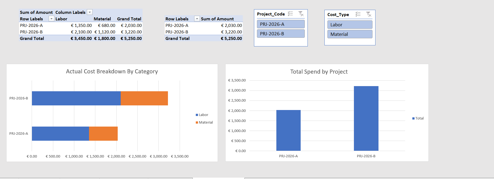

# Excel Financial Controlling & Pricing Model

## Executive Overview
Designed and implemented an end-to-end financial controlling and commercial pricing engine in Excel. The model standardizes direct cost calculation, applies burdened labor rates, tracks material lead times, and enforces targeted gross margin pricing across multi-phase projects.


## Key Features & Financial Logic
* **Burdened Labor Rate Engine:** Incorporates base hourly wages and overhead burden percentages to capture true labor costs.
* **Margin-Based Pricing:** Implements dynamic pricing math ({Cost} / [1 - {Margin}]) with contingency risk buffers.
* **Supply Chain Tracking:** Integrated lead-time metrics to identify potential project bottlenecks.
* **Executive Dashboard:** Features interactive PivotTables, connected Slicers, and side-by-side PivotCharts for real-time cost variance analysis.

## Repository Structure

* Excel_Financial_Controlling_Model.xlsx   # Main Excel Workbook
* README.md                                # Project Documentation
* Images/                                  # Preview Screenshots
```